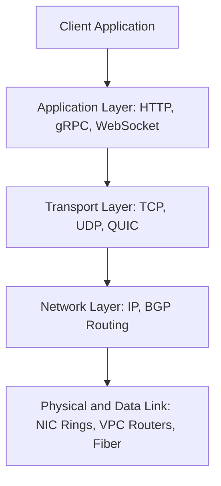
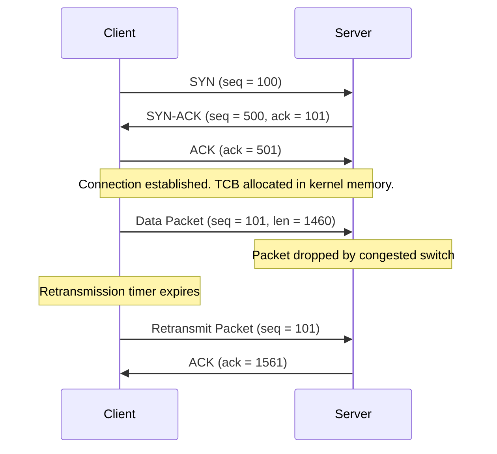
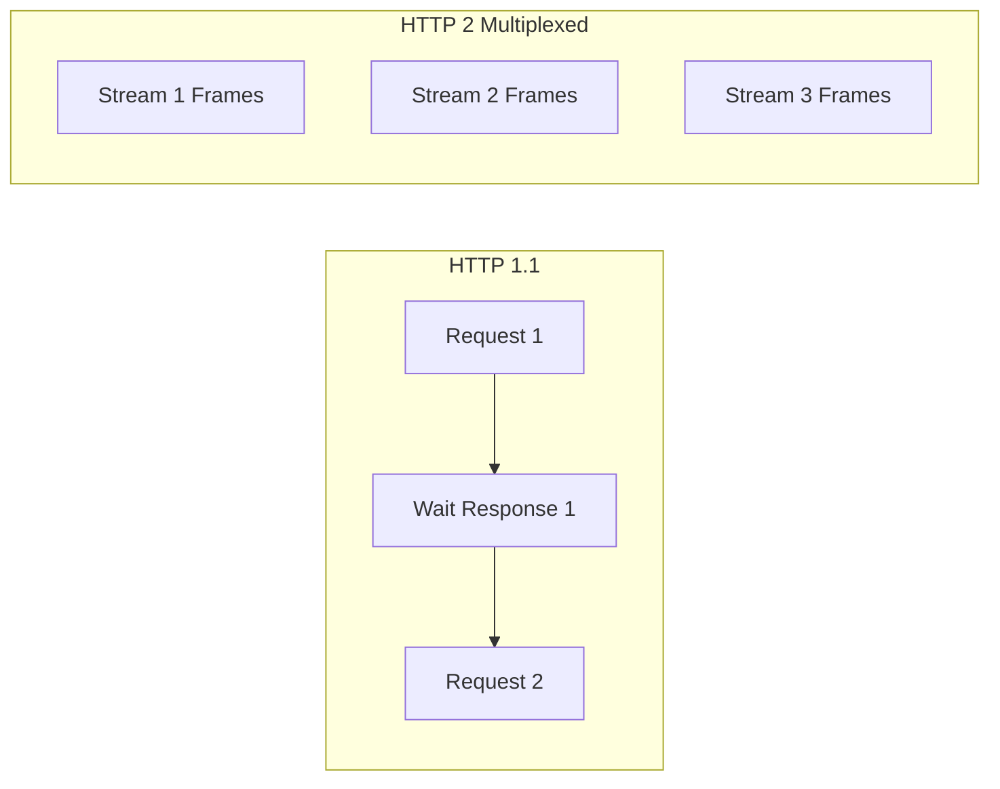
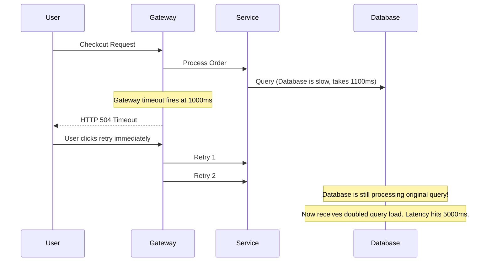

---
hide:
    - toc
    - navigation
---

# Network Protocols and Distributed Systems Reality

> The physical mechanics of packet transit, Linux kernel socket accounting, TCP state machine failure modes, head of line blocking, and cascading retry amplification under production load.

## The Physical Reality of Packet Switching

A computer network is an asynchronous, distributed message passing substrate with no shared clock, no shared memory, and zero guarantees regarding packet arrival or transit time.

Three non negotiable properties dictate how distributed networks behave in production:

1. **Latency is a distribution, not a constant.** Mean latency is an arithmetic fiction that hides user impact. Queuing latency inside routers and kernel buffers causes tail latency (p99 and p99.9) to diverge by orders of magnitude from p50.
2. **Packet loss is steady state operation.** Physical fiber degradation, Wi-Fi interference, router buffer bloat, and top of rack switch congestion mean packet loss occurs constantly. Systems must treat loss as standard control flow rather than an exceptional fault.
3. **Visibility is inherently partial.** When a remote socket stops responding, an application cannot distinguish between a crashed process, a saturated CPU, a dead network interface card, or an asymmetrical fiber cut. Distributed consensus algorithms exist solely because nodes cannot determine whether peers are dead or merely slow.



In distributed environments, failure cascades propagate upward through the stack. Symptoms manifest at Layer 7 as request timeouts and broken client connections, but the root cause almost always resides in Layer 4 socket queues or Layer 3 congestion drops.

## Layer 3: IP and the Best Effort Model

The Internet Protocol exists to solve host addressing and packet forwarding across heterogeneous networks at global scale. To make global internetworking feasible, IP explicitly refuses to provide delivery guarantees.

### What IP Guarantees

Every IP packet contains a source address, destination address, and payload. Routers inspect the destination header and make a best effort attempt to forward the packet along an optimal next hop based on dynamic routing tables (such as BGP and OSPF).

### What IP Refuses to Guarantee

The IP specification provides zero guarantees regarding:

1. Packet delivery (packets may be dropped silently at any intermediate router).
2. Packet ordering (packet B may arrive long before packet A due to multi path routing).
3. Packet uniqueness (hardware glitches or router re-evaluations can duplicate packets).
4. Packet transit time (transit delays can fluctuate from 2 milliseconds to 10 seconds).

This lack of guarantees is not an architectural defect. It is the exact reason the internet scales globally. By keeping intermediate routers stateless and unburdened by retransmission logic, the core network remains fast and resilient. Reliability is pushed entirely to the communicating endpoints.

## Layer 4: Transport and Connection State

Transport layer protocols transform unreliable best effort packet streams into structured communication abstractions for user applications.



### TCP: Converting Loss into Latency

Transmission Control Protocol (TCP) simulates a reliable, ordered byte stream over an unreliable network. It achieves this abstraction through sequence numbers, acknowledgments, retransmission timers, and sliding receive windows.

The hidden architectural cost of TCP is that **TCP converts packet loss into latency**.

When a single packet in a TCP stream is dropped, the receiving kernel buffer holds all subsequent out of order packets in memory. The kernel cannot deliver byte 1461 to the application until missing byte 1 through 1460 is successfully retransmitted and acknowledged. This phenomenon is known as **head of line blocking**.

When network links experience modest packet drops (even 1% to 2%), TCP throughput collapses not because the physical pipe is full, but because the congestion control window throttles sender throughput and retransmission timeouts stall the byte stream. This explains why distributed system tail latencies explode long before network bandwidth is saturated.

### Congestion Control: Cubic vs BBR

The kernel congestion control algorithm determines how aggressively an endpoint transmits packets:

| Algorithm | Signal Evaluated | Operational Trade-Off |
| --- | --- | --- |
| Reno / Cubic | Packet Loss | Assumes loss indicates link saturation. On high speed long distance links, random packet loss causes throughput collapse. |
| BBR (Bottleneck Bandwidth and RTT) | Round Trip Time and Bandwidth | Models link capacity directly without assuming loss implies congestion. Maintains high throughput on lossy, high bandwidth links. |

Modern high throughput services running on Linux kernels 5.4+ should transition default congestion control to BBR (`net.ipv4.tcp_congestion_control = bbr`) to prevent buffer bloat and avoid throughput collapse across cloud regions.

### UDP: The Unvarnished Network

User Datagram Protocol (UDP) strips away transport layer illusions. It provides port multiplexing and an optional checksum, but adds zero retransmission, zero ordering, and zero flow control.

UDP is appropriate strictly when:

1. Low latency is paramount and stale data is useless (live media streaming, voice telephony, multiplayer gaming state).
2. The application implements its own customized loss recovery and congestion mechanics.

Attempting to build naive retransmission and sequence ordering on top of UDP without decades of congestion control engineering almost invariably recreates a fragile, buggy version of TCP.

## Layer 7: Application Protocols and Connection Lifecycle

Layer 7 is where application logic interacts with network abstractions. Mismatched assumptions here generate severe production outages.



### REST over HTTP/1.1 vs HTTP/2

HTTP/1.1 relies on persistent TCP connections (`Keep-Alive`), but each connection can only process a single request and response cycle at a time. Concurrency requires allocating multiple TCP connections (typically six connections per domain in web browsers).

HTTP/2 introduces binary framing and stream multiplexing over a single TCP connection. Multiple concurrent requests and responses interleave frames across the same socket.

However, HTTP/2 introduces a subtle operational trap: **TCP level head of line blocking across streams**. Because all HTTP/2 streams share a single underlying TCP connection, if a single packet is lost on the network, the entire TCP connection stalls. Every multiplexed HTTP/2 request pauses until the lost packet is retransmitted. Under lossy network conditions, HTTP/1.1 with multiple independent TCP connections can actually outperform HTTP/2 in tail latency.

### HTTP/3 and QUIC: Solving Head of Line Blocking

HTTP/3 resolves this constraint by replacing TCP with QUIC running over UDP. QUIC moves connection state, encryption (TLS 1.3), and stream multiplexing into user space.

In QUIC, each stream is independent. If a packet belonging to Stream 1 is lost, Stream 2 and Stream 3 continue processing without delay. Furthermore, QUIC supports connection migration: an active mobile connection can transition from Wi-Fi to cellular networks without resetting the underlying connection, because connections are identified by 64-bit Connection IDs rather than the traditional four tuple (source IP, source port, destination IP, destination port).

## Production Failure Modes and Socket Tuning

When high scale services crash or experience unexplained latency spikes, the root cause is frequently misconfigured kernel socket parameters.

### Socket Exhaustion in TIME_WAIT

When an active HTTP client closes a TCP connection, the local kernel keeps the socket in `TIME_WAIT` state for two times the Maximum Segment Lifetime (typically 60 seconds). This state prevents delayed packets from an old connection from corrupting a new connection using the same four tuple.

However, if a microservice issues thousands of outbound HTTP requests per minute using ephemeral connections without connection pooling, the system exhausts all available local ephemeral ports (`/proc/sys/net/ipv4/ip_local_port_range`). Subsequent socket creation calls fail immediately with `EADDRNOTAVAIL` (Cannot assign requested address).

**Remediation:**
Always use pooled HTTP clients (`http.Transport` in Go, `urllib3.PoolManager` in Python, `HttpClient` connection pooling in Java). In high throughput outbound proxies, enable TCP socket reuse:

```ini
# /etc/sysctl.d/99-network.conf
net.ipv4.tcp_tw_reuse = 1
net.ipv4.ip_local_port_range = 10240 65535
```

### Kernel Socket Buffer Sizing

When throughput is high, small socket buffers (`SO_RCVBUF` and `SO_SNDBUF`) create artificial throughput ceilings. The TCP receive window cannot exceed the size of the receive buffer.

```ini
# Increase Linux autotuning maximum socket buffer sizes to 16MB
net.core.rmem_max = 16777216
net.core.wmem_max = 16777216
net.ipv4.tcp_rmem = 4096 87380 16777216
net.ipv4.tcp_wmem = 4096 65536 16777216
```

### Keepalive Mismatches Across Reverse Proxies

A common source of sporadic HTTP 502 Bad Gateway errors involves idle timeout mismatches between cloud load balancers and upstream backend servers.

If an AWS Application Load Balancer has an idle timeout of 60 seconds, but your backend Node.js, Go, or Gunicorn server has an idle keepalive timeout of 50 seconds:

```
t = 0s     Request A completes. Connection goes idle.
t = 50s    Backend server decides connection is stale and sends FIN packet to close.
t = 50.01s ALB routes a new customer Request B down the same connection.
Result: The request collides with the FIN packet. ALB receives TCP RST.
Client receives an immediate HTTP 502 Bad Gateway.
```

**Rule:** Upstream reverse proxies must always maintain a shorter idle keepalive timeout than downstream backend application servers. Ensure backend server idle timeouts exceed the load balancer timeout by at least five to ten seconds.

## Cascading Failures: The Anatomy of a Retry Storm

The most destructive network failure in distributed architectures is the self inflicted retry storm.



When an upstream dependency slows down, client timeouts fire while the downstream service is still expending CPU cycles processing the initial request. When the client retries, it injects additional load into a service that is already drowning.

### The Mathematics of Safe Retries

To prevent retry storms, distributed systems must enforce three strict rules:

1. **Idempotency Verification:** Never retry non idempotent mutations unless guarded by an idempotency key.
2. **Exponential Backoff with Full Jitter:** Fixed retry intervals synchronize requests into thundering herds. Use randomized exponential backoff:

```python
import random

def calculate_backoff(attempt: int, base_delay: float = 0.1, max_delay: float = 10.0) -> float:
    # Full jitter algorithm: random value between 0 and min(max_delay, base * 2^attempt)
    temp = min(max_delay, base_delay * (2 ** attempt))
    return random.uniform(0, temp)
```

3. **Global Retry Budgets:** Never allow retries to exceed a fixed percentage (such as 10%) of total service traffic. If an upstream service is dropping 50% of requests, retrying all failed calls doubles incoming request volume and guarantees total system collapse.

## Essential Linux Network Diagnostics

When debugging production network anomalies, skip generic tools and query the Linux kernel socket state directly:

```bash
# Inspect internal TCP state, RTT, retransmission counters, and socket buffer queue depth
ss -tiem 'sport = :8080'

# Check for dropped packets and ring buffer overruns on network interface
ethtool -S eth0 | grep -E 'drop|error|miss'

# Monitor kernel connection tracking table saturation
conntrack -C
cat /proc/sys/net/netfilter/nf_conntrack_count

# Inspect TCP retransmission and out of order segments cluster wide
cat /proc/net/snmp | grep -A 1 Tcp:
```

## Summary Reference

| Problem | Root Mechanism | Diagnostic Command | Production Solution |
| --- | --- | --- | --- |
| Sporadic 502 Bad Gateway | Reverse proxy and backend keepalive mismatch | `tcpdump -nn -i any 'tcp[tcpflags] & tcp-rst != 0'` | Set backend idle timeout higher than load balancer |
| Port Exhaustion (EADDRNOTAVAIL) | Ephemeral port depletion in TIME_WAIT | `ss -s` | Implement connection pooling and enable `tcp_tw_reuse` |
| Throughput Collapse on Fast Link | Buffer exhaustion and loss based congestion control | `ss -ti` (check cwnd and rtt) | Increase rmem_max and switch to BBR congestion control |
| Head of Line Latency Spikes | TCP packet loss stalling multiplexed HTTP/2 streams | `netstat -s | grep "retransmitted"` | Migrate to HTTP/3 QUIC over UDP |
| Service Outage from Slow Dependency | Unbounded retries without jitter or budgets | Graph request rate derivative during incident | Enforce retry budgets and full jitter exponential backoff |

Distributed networks do not fail because engineers fail to understand application frameworks. They fail because software abstractions attempt to hide the physical constraints of routing, packet buffers, and latency distributions. Designing for resilience begins with accepting that the network will drop packets, stall sockets, and reorder data at the worst possible operational moments.
